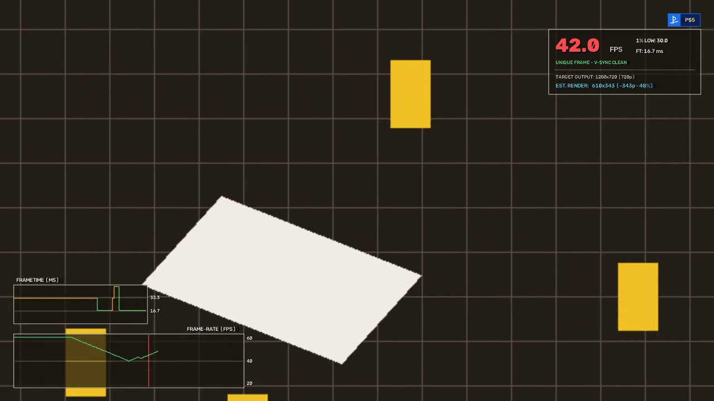

# Frametime & Resolution Analyzer (`fta`)

[](https://github.com/mathiasdbo/Frametime-analyzer-tool/actions/workflows/tests.yml)
[](https://mathiasdbo.github.io/Frametime-analyzer-tool/)
[](https://github.com/mathiasdbo/Frametime-analyzer-tool/releases/latest)
[](LICENSE)

A studio-grade **Video Performance, Frametime, Screen Tearing, and Internal Render Resolution Analyzer** inspired by Digital Foundry's *FPSGui* and *TrDrop*, built for **Elgato 4K S** and UVC capture workflows.

📖 **Documentation: <https://mathiasdbo.github.io/Frametime-analyzer-tool/>** (installation, desktop app guide, HUD layouts, command-line reference, troubleshooting).



## Key Features

- **Accurate Frametime & Frame-Pacing Engine**:
  - Supports **60, 120, and 240 FPS** (including fractional 59.94 / 119.88 Hz) capture files and live streams.
  - **Tile-Based Luma Differenz ($16 \times 9$ grid)** + **HUD Exclusion Masking** + **Adaptive EMA & Noise-Floor Calibration** prevent false positives during static scenes, 30 FPS cadences, or animated HUD elements.
  - Computes rolling FPS, instantaneous frametime (ms), and **1% / 0.1% Low FPS**.
- **Screen Tearing Detection**:
  - Detects horizontal tear scanlines via temporal row-difference step transitions and horizontal seam anomalies, plotting exact tear Y-coordinates on the HUD and timeline.
- **Hybrid Target vs. Internal Render Resolution Analyzer**:
  - **Active Target Resolution Detector**: Automatically strips letterbox/pillarbox bars to determine the true target output viewport.
  - **Automated Per-Frame DRS Estimator**: Combines normalized 1-pixel **Edge-Spread Function (ESF) Slope** ($\frac{|\nabla_{1\text{px}} I|}{\text{Contrast}_{7\times 7}(I)} \approx \frac{H_{\text{render}}}{H_{\text{target}}}$) with **Scale-Space Re-Upscaling Gradient Retention** to track Dynamic Resolution Scaling (DRS) frame-by-frame.
  - **Interactive Digital Foundry-Style Stair-Step Pixel Counter**: Drag across any diagonal edge in the Studio UI (or click **Auto-Detect Edges**) to count discrete aliasing stair-steps and compute the exact internal render resolution.
- **Studio-Grade Video & Telemetry Exports**:
  - **Burned-In Video (`.mp4`/`.mov`)**: GPU-accelerated H.264 when available (VideoToolbox on macOS; NVENC, Quick Sync or AMF on Windows; NVENC, VAAPI or Quick Sync on Linux), automatic fallback to `libx264`, with audio passthrough.
  - **Transparent Alpha Overlay (`.mov` ProRes 4444 / `.webm` VP9)**: Drop directly onto an upper timeline track in DaVinci Resolve, Final Cut Pro, or Premiere Pro.
  - **CSV & JSON Telemetry**: Full per-frame metrics and aggregate clip summary.
- **Desktop GUI (Windows / macOS / Linux)**:
  - `fta gui` opens a native Qt (PySide6) app as an alternative to the terminal: live HUD preview, drag-to-place elements, editable labels, platform badge & brand logo, extra info panel, and one-click processing with progress and cancel.
- **Interactive Studio GUI & Live OBS Browser Source**:
  - Launch `fta studio` to scrub frames, inspect frame-difference views, and measure pixel stair-steps. `http://127.0.0.1:8000/obs-overlay` is a transparent OBS Browser Source that plays back the loaded video's analysis.

---

## Installation

Works on **Windows 10/11, macOS and Linux**. Pick one of three ways to install it.

### Option 1: Download the app (no Python needed)

Download the file for your system from the [**Releases page**](https://github.com/mathiasdbo/Frametime-analyzer-tool/releases/latest):

| System | File | How to start it |
|---|---|---|
| Windows 10/11 (64-bit) | `FrametimeAnalyzer-<version>-windows-x64.zip` | Unzip, then double-click `FrametimeAnalyzer.exe` |
| macOS (Apple Silicon) | `FrametimeAnalyzer-<version>-macos-arm64.zip` | Unzip, then drag **Frametime Analyzer.app** to *Applications* |
| Linux (x86-64) | `FrametimeAnalyzer-<version>-linux-x86_64.tar.gz` | `tar -xzf FrametimeAnalyzer-*.tar.gz && ./FrametimeAnalyzer/FrametimeAnalyzer` |

The download also contains the `fta` command-line tool next to the app:
```bash
# Windows (PowerShell, inside the unzipped folder)
.\fta.exe analyze capture.mp4 -o capture_analyzed.mp4
# macOS
"/Applications/Frametime Analyzer.app/Contents/MacOS/fta" analyze capture.mp4 -o capture_analyzed.mp4
# Linux
./FrametimeAnalyzer/fta analyze capture.mp4 -o capture_analyzed.mp4
```

The apps are not code-signed yet, so on first launch:
- **Windows**: SmartScreen may show "Windows protected your PC". Click **More info → Run anyway**.
- **macOS**: right-click the app → **Open** → **Open**. If macOS says the app is damaged, run `xattr -dr com.apple.quarantine "/Applications/Frametime Analyzer.app"` once.

### Option 2: Install with pipx or uv (Python 3.9+)

This installs the `fta` and `fta-gui` commands in their own isolated environment. Install [pipx](https://pipx.pypa.io/stable/installation/) (or [uv](https://docs.astral.sh/uv/getting-started/installation/)) first, then:

```bash
# Latest code from GitHub
pipx install "frametime-analyzer[gui] @ git+https://github.com/mathiasdbo/Frametime-analyzer-tool.git"
# or
uv tool install "frametime-analyzer[gui] @ git+https://github.com/mathiasdbo/Frametime-analyzer-tool.git"

# Once published on PyPI
pipx install "frametime-analyzer[gui]"

fta --version        # check the install
fta-gui              # start the desktop app
```

Leave out `[gui]` for a command-line-only install. Update later with `pipx upgrade frametime-analyzer` (or `uv tool upgrade frametime-analyzer`).

### Option 3: From source (for development)

Requires Python 3.9+. No separate FFmpeg install is needed: a bundled FFmpeg is used when none is on your `PATH`.

**macOS / Linux**
```bash
git clone https://github.com/mathiasdbo/Frametime-analyzer-tool.git
cd Frametime-analyzer-tool
python3 -m venv .venv
source .venv/bin/activate
pip install -e ".[dev,gui]"
```

**Windows (PowerShell)**
```powershell
git clone https://github.com/mathiasdbo/Frametime-analyzer-tool.git
cd Frametime-analyzer-tool
py -m venv .venv
.venv\Scripts\Activate.ps1
pip install -e ".[dev,gui]"
```

The `gui` extra installs PySide6 for the desktop app (`fta gui`); leave it out for a CLI-only install.

### Platform notes
- **Video encoding**: the burned-in MP4 uses a GPU encoder when one actually works on the machine (VideoToolbox on macOS; NVIDIA NVENC, Intel Quick Sync or AMD AMF on Windows; NVENC, VAAPI or Quick Sync on Linux), otherwise CPU `libx264`. Disable with `--no-hw` (CLI) or the *Use GPU video encoder* checkbox (GUI), or force one with `FTA_VIDEO_ENCODER=libx264` / `h264_nvenc` / ….
- **Live capture** (`fta live`, `fta devices`): uses AVFoundation on macOS, DirectShow (then Media Foundation) on Windows, and V4L2 on Linux. Close OBS / Elgato 4K Capture Utility first, since only one app can open the device. On Linux your user needs access to `/dev/video*` (usually the `video` group); on macOS and Windows allow camera access for your terminal in the privacy settings.
- **Linux desktop GUI**: Qt needs a few system libraries that most desktops already have. On minimal installs: `sudo apt install libegl1 libxkbcommon0 libxcb-cursor0 libfontconfig1`.

## Quick Start

### 1. Run the Built-In Synthetic Elgato Demo
Generates a synthetic capture clip containing 60 FPS, 30 FPS, frame stutters, screen tearing, and dynamic resolution scaling (100% -> 66.7% -> 50%), and exports the analyzed video, ProRes 4444 alpha overlay, CSV, and JSON:
```bash
fta demo
```

### 2. Analyze an Elgato 4K S Recording
```bash
fta analyze capture.mp4 \
  --platform "PS5" \
  --output-video capture_analyzed.mp4 \
  --output-alpha capture_overlay_alpha.mov \
  --output-csv capture_telemetry.csv \
  --output-json capture_summary.json
```
Supported `--platform` badges: `PS5`, `PS5 Pro`, `PS4`, `PS3`, `PS2`, `PS1`, `Xbox Series X`, `Xbox Series S`, `Xbox One`, `Xbox 360`, `Xbox`, `Switch`, `Switch 2`, `Wii U`, `Wii`, `GameCube`, `N64`, `Steam Deck`, `PC`, `Elgato` (or custom PNG via `--logo`).

### 3. Desktop GUI: Customize the HUD & Process Videos
```bash
fta gui                          # or: fta-gui
fta gui --video capture.mp4 --layout my_layout.json
```
- **Input & Output**: pick the capture video (or drag & drop it onto the window); output names are filled in automatically. Choose any of burned-in video, ProRes/WebM alpha overlay, CSV and JSON.
- **Platform & Logos**: console badge preset (or any custom name), custom badge text, custom badge icon PNG, and a free-standing brand / channel logo with size and opacity.
- **Labels**: rename every HUD label (`FPS`, `1% LOW`, `FT`, status texts, graph titles, resolution captions…), e.g. to translate the HUD.
- **Extra Info**: a titled multi-line info panel (game, patch, graphics mode, capture setup…).
- **Placement**: per element visibility, anchor (9 positions) and X/Y offset, plus global HUD size, panel opacity and section toggles. You can also simply **drag elements in the preview**.
- **Resolution (manual override)**: if the DRS estimate is wrong, set the target output resolution manually and choose the internal render mode: *Auto* (per-frame estimate), *Auto clamped to a known DRS range* (e.g. 1440p–2160p), or *Fixed* (one resolution, no DRS). The manual values are used for the HUD, CSV/JSON and the summary.
- **Process Video** runs the analysis in the background with a progress bar and cancel button.

Layouts are saved as JSON (*File ▸ Save HUD Layout*) and are reusable from the terminal:
```bash
fta analyze capture.mp4 -o capture_analyzed.mp4 --layout my_layout.json --info "Performance Mode" --info "Patch 1.04"
```
Manual resolutions are available from the terminal too:
```bash
fta analyze capture.mp4 -o out.mp4 --target-res 3840x2160 --render-res 2560x1440    # fixed, no DRS
fta analyze capture.mp4 -o out.mp4 --target-res 3840x2160 --render-range 1440-2160  # clamp the DRS estimate
```
Offsets are in 1080p reference pixels and scale with the video resolution, so one layout works for 720p, 1080p and 4K captures.

### 4. Launch the Interactive Analyzer Studio & OBS Overlay Server
```bash
fta studio --video capture.mp4
```
- Open **http://127.0.0.1:8000** for the interactive Frame & Pixel-Counting Studio.
- Add **http://127.0.0.1:8000/obs-overlay** (`1920x1080`) as a **Browser Source** in OBS Studio: a transparent HUD that plays back the analysis of the video loaded in the Studio (it does not measure the live OBS scene; use `fta live` for that).

### 5. Live Elgato 4K S / UVC Capture Analysis
```bash
fta devices
fta live --device 0 --width 1920 --height 1080 --fps 60
```

---

## Releasing (maintainers)

See the [release guide](docs/releasing.md). In short: bump `__version__` in `src/frametime_analyzer/__init__.py`, merge to `main`, then push a tag:
```bash
git tag v0.2.0
git push origin v0.2.0
```
GitHub Actions builds the Windows, macOS and Linux apps plus the Python packages, smoke-tests them, and publishes a GitHub Release (and PyPI, once enabled).

## Contributing

Bug reports, sample captures and pull requests are welcome: see [CONTRIBUTING.md](CONTRIBUTING.md). Report security issues privately as described in [SECURITY.md](SECURITY.md).

## License

MIT, see [LICENSE](LICENSE). The standalone downloads also bundle third-party software under its own licenses, notably Qt / PySide6 (LGPLv3), OpenCV (Apache 2.0) and FFmpeg (GPL build from `imageio-ffmpeg`).
