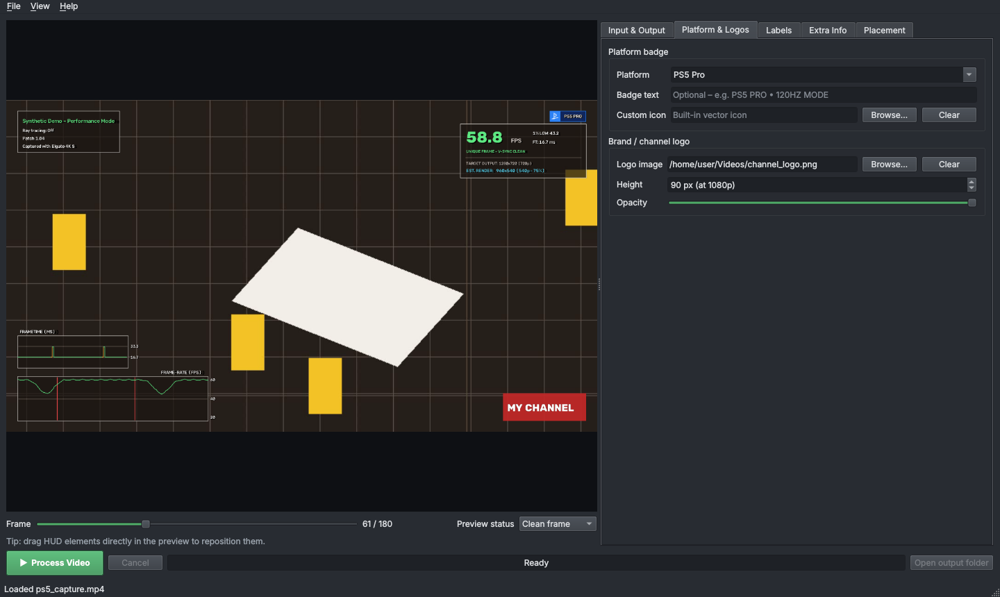
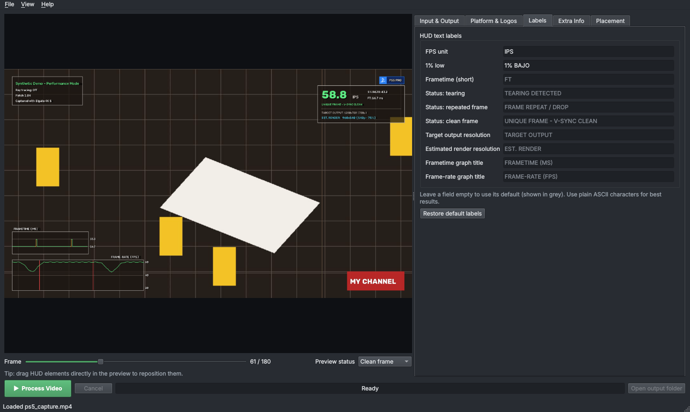
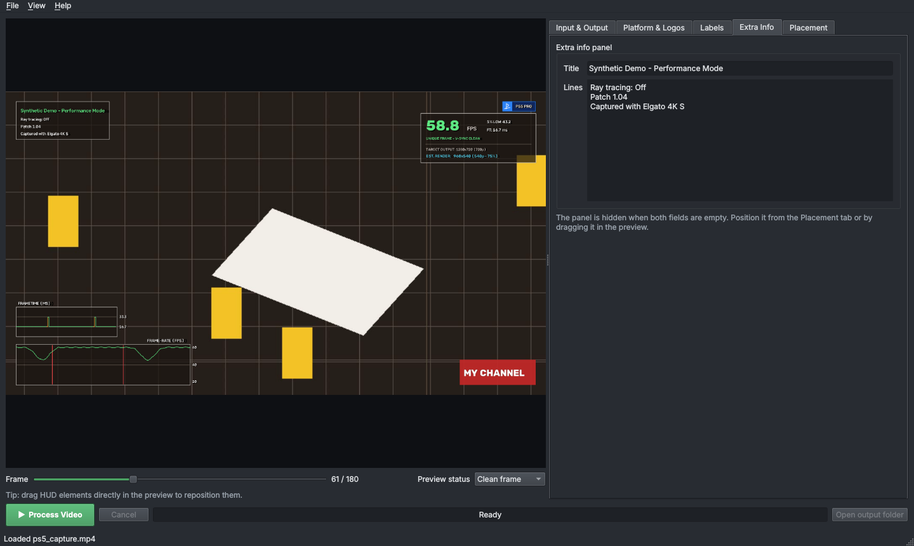
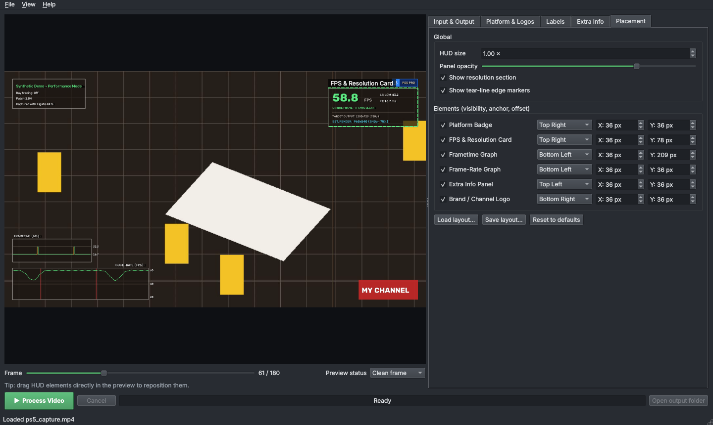

# Desktop app

The desktop app (`fta gui`, `fta-gui`, or the downloaded **FrametimeAnalyzer** app) lets you design the HUD on your actual video and process it, without using the terminal.

```bash
fta gui
fta gui --video capture.mp4 --layout my_layout.json   # open both right away
```

## The window


- **Preview (left)**: the selected frame of your video with the HUD drawn on it, exactly as it will be exported.
    - **Frame** slider: scrub through the video.
    - **Preview status**: show how a *clean frame*, a *frame repeat* or *screen tearing* look on the HUD.
    - **Drag any HUD element** with the mouse to move it. Hovering shows a dashed outline and the element's name.
- **Settings (right)**: five tabs, described below. Every change updates the preview immediately.
- **Bottom bar**: **▶ Process Video**, **Cancel**, the progress bar, and **Open output folder** when finished.

The preview's graphs use sample data so you can judge the look before processing. Your video's real measurements appear in the exported files.

You can also **drag and drop** files onto the window: a video opens it, a `.json` file loads it as a HUD layout, and an image becomes the brand logo.

## Input & Output

**Source video**: choose the capture (MP4, MOV, MKV, AVI, WebM…). Its resolution, frame-rate, frame count and duration are shown underneath.

**Outputs**: tick the files you want. Names are filled in next to the source video automatically and can be changed.

| Output | Notes |
|---|---|
| Burned-in video | H.264 `.mp4` / `.mov` with the HUD, original audio copied |
| Alpha overlay | `.mov` = ProRes 4444 with alpha; `.webm` = VP9 with alpha |
| CSV telemetry | One row per frame, see [Outputs](outputs.md#csv-telemetry) |
| JSON summary | Clip summary + every frame, see [Outputs](outputs.md#json-summary) |

**Analysis**:

- *Detect screen tearing*: turn off for captures that can't tear (e.g. V-Sync locked) to save time.
- *Estimate target & internal render resolution*: turn off to skip resolution analysis. The HUD's resolution section is then hidden unless you set it manually.
- *Use GPU video encoder when available*: see [Platform notes](platforms.md#video-encoding).
- *Frame limit*: process only the first N frames, handy for testing settings.

**Resolution (manual override)**: when the automatic estimate is wrong. See [Resolution & DRS](resolution.md).


## Platform & Logos



- **Platform**: choose a preset (PS5, PS5 Pro, PS4, PS3, PS2, PS1, Xbox Series X|S, Xbox One, Xbox 360, Xbox, Switch 2, Switch, Wii U, Wii, GameCube, N64, Steam Deck, PC, Elgato) or type any name to get a generic badge.
- **Badge text**: replace the text on the badge, e.g. `PS5 PRO - 120HZ MODE`.
- **Custom icon**: replace the console icon with your own image (a square PNG with transparency works best).
- **Brand / channel logo**: a separate image placed anywhere on screen, with its height (in 1080p pixels) and opacity.

## Labels



Rename any text drawn on the HUD, for example to translate it. Empty fields use the default shown in grey. **Restore default labels** resets them all.

!!! note
    The HUD font only supports plain ASCII characters. Common symbols are converted (`•` and `–` become `-`, `×` becomes `x`), and other characters are shown as `?`.

## Extra Info



An optional panel with a highlighted **title** and any number of **lines**: game, patch, graphics mode, capture setup, and so on. It's hidden while both are empty.

## Placement



**Global**:

- **HUD size**: scales the whole HUD (on top of the automatic scaling for the video's resolution).
- **Panel opacity**: transparency of the dark panel backgrounds.
- **Show resolution section** and **Show tear-line edge markers**.

**Elements**: for each of the six elements (platform badge, FPS & resolution card, frametime graph, frame-rate graph, extra info panel, brand logo) you can set:

- **Visible**: show or hide it.
- **Anchor**: which of nine screen positions it attaches to (corners, edge centers, center).
- **X / Y offset**: distance from that anchor, in 1080p pixels.

Clicking an element in the preview selects it here; dragging it updates the offsets. See [HUD customization](hud-layout.md) for exactly how anchors and offsets work.

## Saving and reusing layouts

- *File ▸ Save HUD Layout…* (++ctrl+s++ / ++cmd+s++) writes a `.json` file, and *File ▸ Load HUD Layout…* (++ctrl+l++) reads one.
- *File ▸ Reset HUD Layout* returns to the defaults.
- The app remembers your last layout between sessions.

A saved layout works with the command line too:

```bash
fta analyze capture.mp4 -o out.mp4 --layout my_layout.json
```

Video and resolution settings are per video and aren't stored in the layout.

## Processing

Press **▶ Process Video**. Before starting, the app checks:

- the input exists,
- at least one output is enabled,
- no output path overwrites the input,
- and asks before overwriting existing files.

Processing runs in the background, so you can keep tweaking the layout for the next video. Changes don't affect a run that has already started. **Cancel** stops after the current frame and keeps what was written so far. When it finishes, a summary is shown and **Open output folder** becomes available.

## Keyboard shortcuts

| Action | Shortcut |
|---|---|
| Open video | ++ctrl+o++ / ++cmd+o++ |
| Save HUD layout | ++ctrl+s++ / ++cmd+s++ |
| Load HUD layout | ++ctrl+l++ / ++cmd+l++ |
| Quit | ++alt+f4++ (Windows), ++ctrl+q++ (Linux), ++cmd+q++ (macOS) |

*View ▸ Show Element Guides* toggles the hover / selection outlines in the preview.
