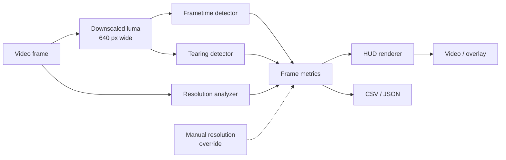

# How the analysis works

This page explains what the analyzer measures and how, so you can judge the numbers and know when to override them.

Each frame goes through three detectors. Their results are combined into per-frame metrics, which drive the HUD and the [telemetry](outputs.md):



## Frametime & frame-rate

A capture records at the capture card's refresh rate (e.g. 60 Hz), but a game may produce fewer frames: at 30 FPS on a 60 Hz capture, every game frame appears twice. The analyzer finds these **repeated frames** to recover the game's real frame timing.

### Detecting repeated frames

1. Each frame is converted to a 640-pixel-wide grayscale (luma) image.
2. It's compared with the **previous unique frame** and split into a **16 × 9 grid of tiles**. The analyzer measures the average brightness change in each tile.
3. If only a few tiles change (less than 15%), it uses a robust percentile of the tiles instead of the full-frame average, so an animated HUD element, like a spinning save icon or a minimap, doesn't count as new frame content.
4. The frame counts as a **repeat** when this motion value is below an **adaptive threshold**: 25% of the recent typical motion (an exponential moving average updated on unique frames only), and never below a fixed noise floor. The threshold follows the scene, so slow pans aren't mistaken for repeats and compression noise isn't mistaken for motion.

### From repeats to numbers

- **Frametime**: how long each unique game frame stayed on screen. A frame shown for two 60 Hz refreshes has a frametime of 33.3 ms.
- **Rolling FPS**: unique frames during the last second.
- **1% / 0.1% low**: \( 1000 / \text{frametime} \) at the 99th / 99.9th percentile of all frametimes so far, the usual way to express stutter.
- **Average FPS** (summary): unique frames ÷ clip duration.

Timing comes from the video's timestamps, so variable-frame-rate recordings and fractional rates (59.94, 119.88 Hz) are handled. Capture at least at the game's frame-rate: a 120 FPS game needs a 120 Hz capture to be measured.

## Screen tearing

A torn frame shows the top part of one game frame and the bottom part of the next, split by a horizontal line. The detector compares each frame with the previous one, row by row:

1. **Row change profile**: how much each row changed since the previous frame.
2. **Step search**: a tear has one side that barely changed (still the old frame) and one side that changed a lot (the new frame). The detector looks for rows where the change profile steps from "quiet" to "busy".
3. **New seams**: it also checks for a horizontal discontinuity that wasn't in the previous frame, and requires it to stand out from the rest of the frame (a robust z-score of at least 2).
4. **Whole-frame check**: the region above or below the candidate row must be static overall, and the other side must have changed.

Up to two tear lines are reported per frame. Detected tear positions are scaled back to source pixels, drawn as red markers on the HUD, and listed in `tear_line_y`. Torn frames also appear as red lines in the frame-rate graph.

## Resolution

### Target output resolution

The detector removes near-black bars at the edges (letterbox / pillarbox: rows and columns whose brightest pixels stay below a low threshold) to find the active game image. Bars within 6 pixels of the edge are ignored. Its size is the **target resolution**.

### Internal render resolution

When a game renders at a lower resolution and upscales, edges get softer: a native edge changes brightness within about one pixel, an upscaled edge over several. The analyzer estimates the upscale factor from:

1. **Normalized edge-spread slope**: on strong edges in the 3D image, the 1-pixel brightness step divided by the local contrast. This ratio is roughly the render-to-target height ratio:

    \[
    \frac{|\nabla_{1\text{px}} I|}{\text{Contrast}_{7\times7}(I)} \approx \frac{H_\text{render}}{H_\text{target}}
    \]

2. **Scale-space re-upscaling**: how much gradient energy survives being downscaled and upscaled again. Detail beyond the render resolution was never there, so it barely changes.

When there are enough strong edges (confidence ≥ 0.55), the edge-spread estimate is used. Otherwise it's blended 70 / 30 with the re-upscaling estimate. Measurements run every 3rd frame, are smoothed with the median of the last 12, and are snapped to a standard tier (720p, 900p, 1080p, 1296p, 1440p, 1620p, 1800p, 2160p…) when within about 2% of the target height. The summary reports **DRS** when the render height varies by 36 px or more over the clip.

Because temporal upscalers and post-processing can fool this (see [Resolution & DRS](resolution.md#when-the-estimate-can-be-wrong)), you can always [override the resolution manually](resolution.md#manual-override).

## Default parameters

These are the analyzer's defaults (`AnalyzerConfig` in `models.py`). They aren't exposed on the command line yet; change them from Python if you need to.

| Parameter | Default | Used for |
|---|---|---|
| `analysis_width` | 640 | Width of the luma image used for motion and tearing |
| `grid_cols` × `grid_rows` | 16 × 9 | Motion tiles |
| `noise_floor_luma` | 0.32 | Minimum brightness change counted as motion |
| `ema_alpha` | 0.20 | How fast the typical-motion average adapts |
| `relative_drop_ratio` | 0.25 | Repeat threshold as a fraction of typical motion |
| `hud_exclusion_boxes` | none | Normalized screen areas ignored for motion, e.g. a static game HUD |
| `tear_min_region_diff` | 1.5 | Minimum change on the "new frame" side of a tear |
| `detect_tearing`, `detect_resolution` | on | Same as `--tearing` / `--resolution` |
| `resolution_sample_interval` | 3 | Measure resolution every N frames |
| `drs_smoothing_window` | 12 | Number of measurements in the median smoothing |

```python
from frametime_analyzer.models import AnalyzerConfig
from frametime_analyzer.core.pipeline import AnalysisPipeline

config = AnalyzerConfig(hud_exclusion_boxes=[(0.80, 0.0, 1.0, 0.15)])  # ignore the top-right corner
pipeline = AnalysisPipeline(config)
```
