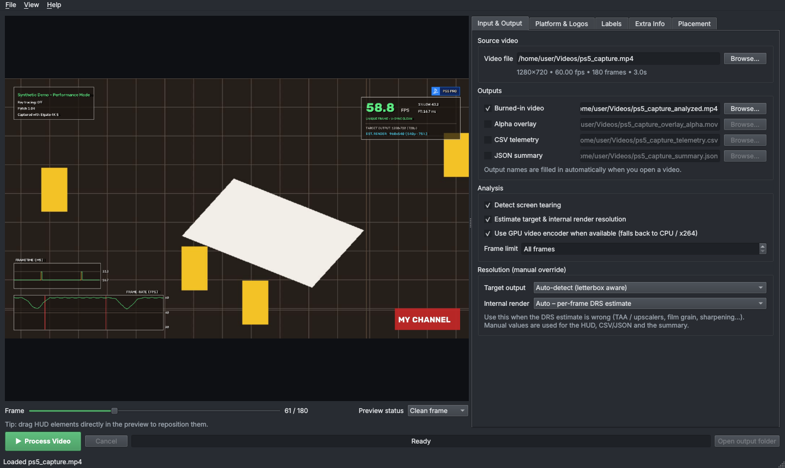

# Quick start

This page takes you from install to an analyzed video in a few minutes. It assumes you've [installed](installation.md) the app.

## 1. Try the built-in demo

Not sure what to expect? Generate a synthetic test clip and analyze it. The clip contains 60 FPS and 30 FPS sections, frame stutters, screen tearing, and dynamic resolution scaling (100% → 66.7% → 50%):

```bash
fta demo
```

This creates a `demo_output/` folder with:

| File | What it is |
|---|---|
| `synthetic_capture.mp4` | The generated input clip |
| `synthetic_analyzed.mp4` | The clip with the HUD burned in |
| `synthetic_overlay_alpha.mov` | The HUD alone, on a transparent background (ProRes 4444) |
| `synthetic_telemetry.csv` | One row of measurements per frame |
| `synthetic_summary.json` | Clip summary plus all per-frame data |

The terminal also prints a summary table: average / min / max FPS, 1% and 0.1% lows, frametime percentiles, torn frames, and the estimated render resolution range.

## 2. Analyze your own capture in the desktop app

```bash
fta gui            # or fta-gui, or double-click the downloaded app
```

1. **Open your video**: *File ▸ Open Video…*, or drag the file onto the window.
2. **Pick the platform** on the *Platform & Logos* tab (PS5, Xbox Series X, Switch 2, PC…).
3. Adjust anything else you like (labels, extra info, placement) while watching the live preview.
4. Choose your outputs on the *Input & Output* tab and press **▶ Process Video**.



The full walkthrough is in [Desktop app](gui.md).

## 3. Or use the command line

```bash
fta analyze capture.mp4 \
  --platform "PS5" \
  --output-video capture_analyzed.mp4 \
  --output-alpha capture_overlay_alpha.mov \
  --output-csv capture_telemetry.csv \
  --output-json capture_summary.json
```

On Windows PowerShell, use a backtick `` ` `` instead of `\` to continue a line, or put everything on one line.

Use a HUD layout you designed in the desktop app, and add info lines:

```bash
fta analyze capture.mp4 -o capture_analyzed.mp4 \
  --layout my_layout.json \
  --info "Performance Mode" --info "Patch 1.04"
```

If the automatic resolution estimate is wrong, tell it what you know:

```bash
fta analyze capture.mp4 -o capture_analyzed.mp4 --target-res 3840x2160 --render-range 1440-2160
```

All options are listed in the [command-line reference](cli.md).

!!! tip "How long does it take?"
    Every frame is analyzed and re-encoded, so processing is usually slower than real time, especially for 4K. Use `--max-frames 600` (or *Frame limit* in the app) to check your settings on the first 10 seconds of a 60 FPS capture before running the whole file.
