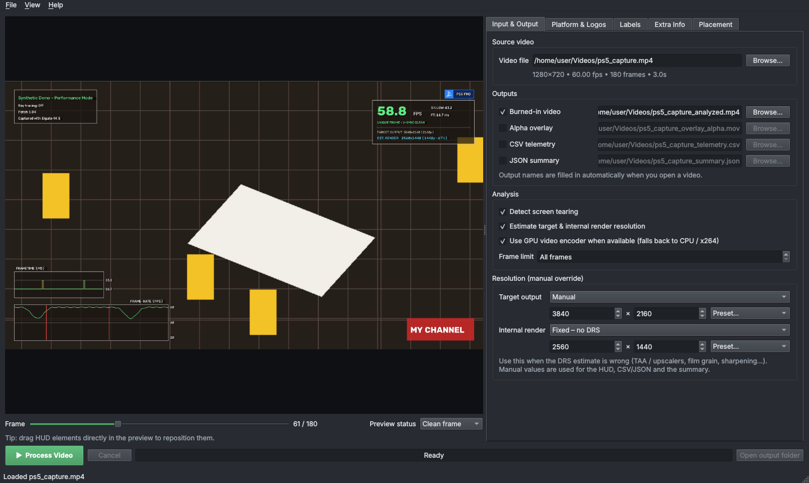

# Resolution & DRS

Frametime Analyzer reports two resolutions for every frame:

- **Target output resolution**: the size of the actual game image in the video, after removing black letterbox / pillarbox bars. A 4K capture of a 4K game is 3840×2160. A 21:9 game in a 16:9 capture has a shorter target height.
- **Estimated internal render resolution**: the resolution the game rendered at before upscaling to the target. Games with **dynamic resolution scaling (DRS)** change it from frame to frame.

Both are shown on the HUD's FPS card and written to the CSV / JSON:

```text
TARGET OUTPUT: 3840x2160 (2160p)
EST. RENDER:   2560x1440 (1440p - 67%)
```

## How the estimate works

The analyzer measures how soft the edges in the 3D image are: an image upscaled from a lower resolution has wider edge transitions. It combines two measurements:

1. **Edge-spread slope**: how much of each strong edge's contrast happens within a single pixel. A native image has sharp 1-pixel steps; an upscaled one spreads them over several pixels.
2. **Scale-space re-upscaling check**: how much detail survives being downscaled and upscaled again at different scales.

The result is smoothed over time: the median of the last 12 measurements, taken every 3rd frame by default, and snapped to a common resolution tier (720p, 900p, 1080p, 1296p, 1440p, 1620p, 1800p, 2160p…) when it's close to one. A value that isn't near a standard tier is shown with a `~`, e.g. `~1386p`. See [How the analysis works](how-it-works.md#resolution) for the details.

## When the estimate can be wrong

Pixel counting from video is hard, even by eye. The automatic estimate can be misled by:

- **Temporal upscalers and reconstruction** (TAA, FSR 2/3, DLSS, PSSR, XeSS, checkerboarding): they produce a sharp image from a lower resolution.
- **Sharpening filters** that make edges look native.
- **Film grain, chromatic aberration, depth of field, motion blur** and heavy post-processing that soften the whole image.
- **Low-detail scenes** (fog, menus, dark areas) with few strong edges.
- **Compressed captures**: low-bitrate video smears edges.

The `resolution_confidence` value in the [telemetry](outputs.md#csv-telemetry) (0–1) tells you how many strong edges the estimate was based on. Treat low-confidence frames with caution.

## Manual override

When you know the real numbers (from the developer, a Digital Foundry analysis, or your own pixel counts), set them yourself. Manual values replace the automatic ones **everywhere**: on the HUD, in the CSV / JSON and in the summary.

### Target output

- **Auto-detect** (default): letterbox-aware detection.
- **Manual**: enter width × height, or pick a preset (720p → 2160p).

### Internal render

| Mode | What it does | Use it when |
|---|---|---|
| **Auto** | Per-frame estimate. If you set a manual target, the estimated *percentage* is applied to your target. | The estimate looks right |
| **Auto, clamped to a range** | Per-frame estimate, limited to a minimum and maximum height | The game uses DRS within a known window (e.g. 1440p–2160p), but the estimate sometimes jumps outside it |
| **Fixed** | One resolution for every frame; no DRS | The game renders at a fixed resolution |

With **Fixed** and a manual target, the automatic resolution analysis is skipped completely, so processing is faster.

### In the desktop app

*Input & Output* tab → **Resolution (manual override)**. The preview shows the result immediately.



### On the command line

```bash
# Fixed 1440p internal resolution on a 4K output
fta analyze capture.mp4 -o out.mp4 --target-res 3840x2160 --render-res 2560x1440

# DRS between 1440p and 2160p: clamp the estimate to that window
fta analyze capture.mp4 -o out.mp4 --target-res 3840x2160 --render-range 1440-2160

# Only correct the target (e.g. letterbox detection got it wrong)
fta analyze capture.mp4 -o out.mp4 --target-res 3840x1600
```

- `--target-res` and `--render-res` take `WIDTHxHEIGHT` (`2560x1440`, `2560*1440` and `2560 1440` also work).
- `--render-range` takes heights `MIN-MAX` (`1440-2160` or `1440p-2160p`).
- `--render-res` and `--render-range` can't be combined.

## Interactive pixel counting

To measure the render resolution yourself, the browser-based [Studio](live-capture.md#studio-fta-studio) has a Digital Foundry-style **stair-step pixel counter**: drag along a clean, high-contrast diagonal edge and it counts the aliasing steps to compute the internal resolution. **Auto-Detect Edges** suggests good edges to measure. Then enter the result as a manual override.
